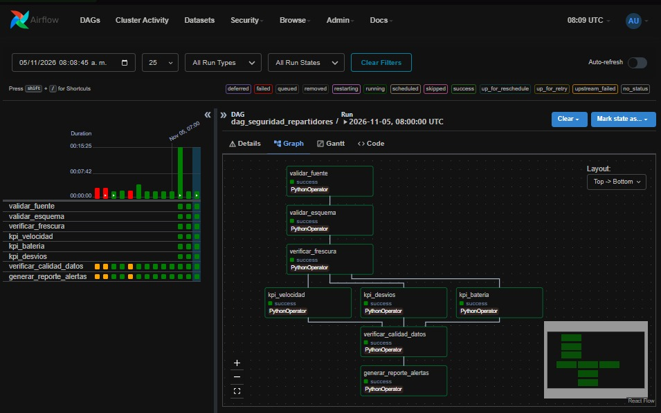
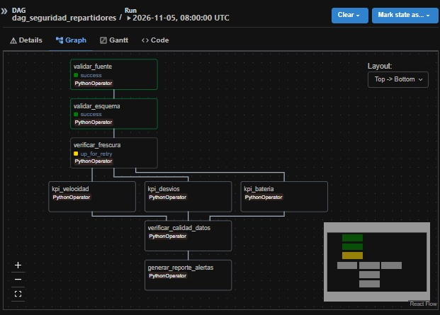
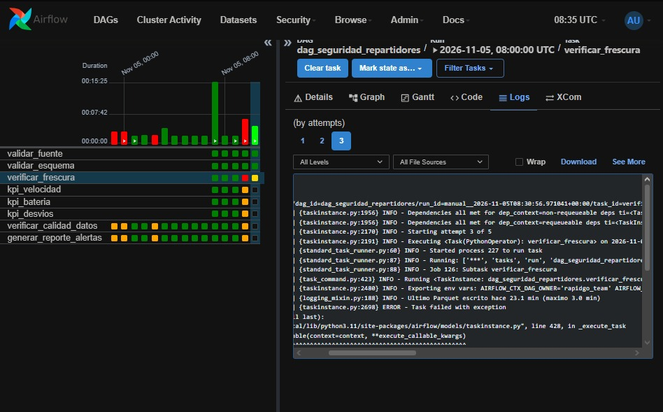
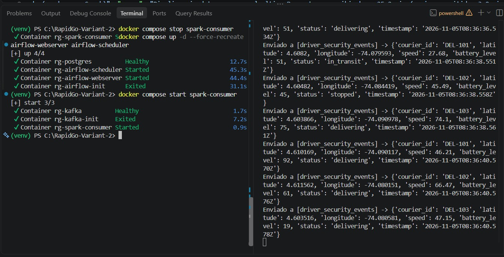
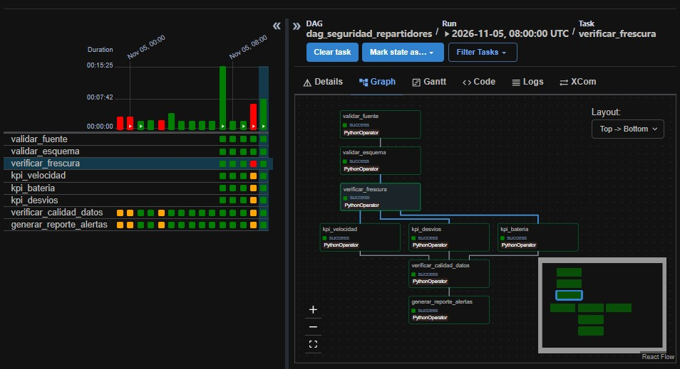

# Checkpoint Semana 3

**1. Qué quedó funcionando esta semana**
- DAG `dag_seguridad_repartidores` con **8 tasks**: `validar_fuente → validar_esquema → verificar_frescura → [kpi_velocidad, kpi_bateria, kpi_desvios] → verificar_calidad_datos → generar_reporte_alertas`.
- **Retries** (`verificar_frescura`: 3 reintentos cada 2 min), **XCom** (`corte_mtime` pasa a los KPIs), tarea de **calidad** y tarea de **reporte**.
- Los fallos quedan registrados en `datalake/curated/incidents/incidentes_<fecha>.jsonl`.
- **CI ampliado:** importa el DAG con `DagBag`, corre una nueva prueba de reglas (batería crítica tiene prioridad sobre exceso de velocidad) y usa Python 3.11.

**2. Valor real observado**
- Pipeline sano: *"Ultimo Parquet escrito hace **0.2 min** (maximo 3.0 min)"* y las 8 tasks en `success`.
- Pipeline caído: *"hace **23.1 min** (maximo 3.0 min)"* y la tarea falló. Se registraron **7 incidentes** en el `.jsonl`.

**3. Decisión técnica y por qué** ([ADR-003](../decisions/ADR-003-orchestration%20and%20failure%20recovery.md))

Separar fallos **transitorios** (se reintentan: frescura, fuente) de **lógicos** (no se reintentan: esquema, calidad), y reemplazar el fallo simulado por uno **real** deteniendo `spark-consumer`.

**4. Problema encontrado y cómo se resolvió**

| Campo | Evidencia |
|---|---|
| **Tarea que falló** | `verificar_frescura` |
| **Mensaje real del log** | `Ultimo Parquet escrito hace 23.1 min (maximo 3.0 min)` → `ERROR - Task failed with exception` |
| **Tareas afectadas** | Las 5 descendientes (`kpi_velocidad`, `kpi_bateria`, `kpi_desvios`, `verificar_calidad_datos`, `generar_reporte_alertas`) no se ejecutaron ni generaron reporte. |
| **Cambio que resolvió el problema** | Se detuvo `spark-consumer` con el producer activo; se reinició con `docker compose start spark-consumer` y *Clear task*. El intento 5 terminó en SUCCESS. |

*Antes del fallo:*

*Fallo:*

*Recuperación:*

*DAG completo en verde:*

**5. Enlaces a Issues**
- **Validar fuentes y datos, generar al menos una tarea de calidad y una salida/reporting:** https://github.com/NicolasfGonzalez/RapidGo-Seguridad/issues/15
- **Provocar un fallo controlado y documentar recuperación**: https://github.com/NicolasfGonzalez/RapidGo-Seguridad/issues/16
- **Ampliar CI para validar/importar DAG y ejecutar nuevas pruebas**: https://github.com/NicolasfGonzalez/RapidGo-Seguridad/issues/17
- **Crear ADR-003 con enfoque en estrategia de orquestación o recuperación ante fallos**: https://github.com/NicolasfGonzalez/RapidGo-Seguridad/issues/18
- **Actualizar documentación a semana 3 (Checkpoint y README)**: https://github.com/NicolasfGonzalez/RapidGo-Seguridad/issues/33

**PR / Action**
- **feat: Orquestación con Airflow, CI ampliado y simulación de fallos- #36:** DAG sobre eventos reales, Docker y CI ampliado: https://github.com/NicolasfGonzalez/RapidGo-Seguridad/pull/36
- **feat: implementar DAG, con 5 task, retries, dependencias y XCom- #35:** DAG con 5 tasks, retries, dependencias y XCom: https://github.com/NicolasfGonzalez/RapidGo-Seguridad/pull/35
- **docs: Crear ADR, registro de checkpoint y actualizar README para la semana 3.** https://github.com/NicolasfGonzalez/RapidGo-Seguridad/pull/37
- **Actions:** https://github.com/NicolasfGonzalez/RapidGo-Seguridad/actions/workflows/ci.yml
