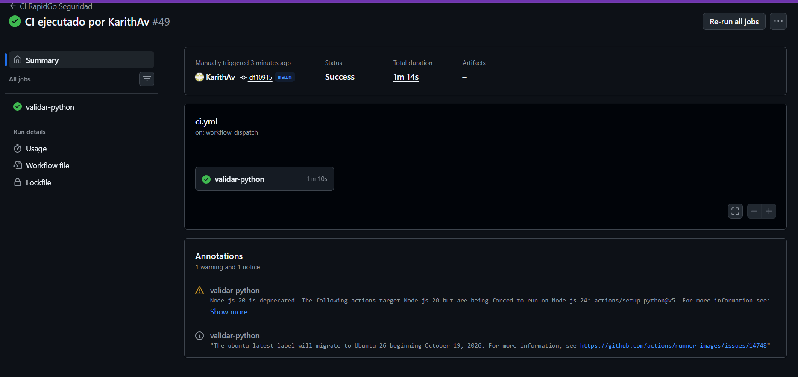
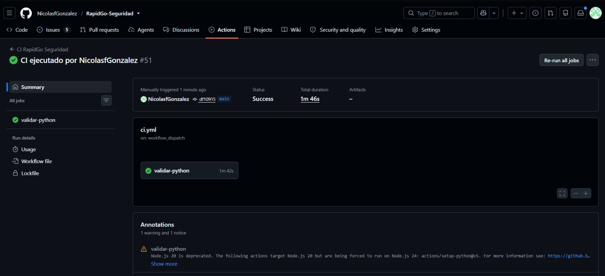
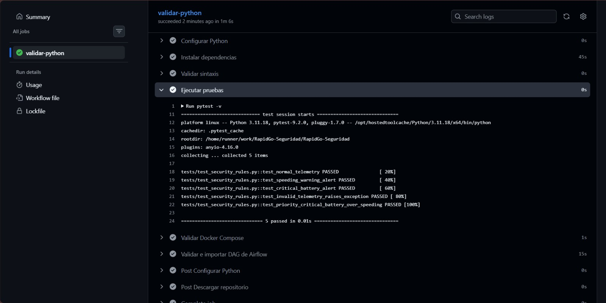

# Checkpoint Semana 4 (Cierre y Release v1.0.0)

**1. Qué quedó funcionando esta semana**
- **Capa Raw en el Data Lake:** Persistencia de datos sin procesar (`datalake/raw/security_telemetry`) directamente desde Kafka en formato Parquet mediante un nuevo flujo (`raw_q`).
- **Estabilidad en Spark Streaming:** Solución del error `AnalysisException` al mover la columna de partición `event_date` al DataFrame principal (`parsed_df`) antes de escribir, optimizando el uso de memoria en la JVM.
- **Checkpoints persistentes:** Configuración de la ruta de control (`checkpointLocation`) conectada al volumen local del Data Lake para garantizar tolerancia a fallos y evitar duplicidad de offsets.
- **Integración por Pull Request y CI:** Unificación de los cambios mediante PR a la rama `main` (lo que habilitó formalmente el botón del disparador manual `workflow_dispatch` para todo el equipo) y ejecución exitosa del pipeline.

**2. Valor real observado**
- El consumidor de Spark (`rg-spark-consumer`) procesa y almacena los datos de forma continua y limpia.
- Se crean automáticamente las carpetas particionadas por fecha (`event_date=2026-...`) tanto en la zona *Raw* como en *Processed*.
- El sistema es totalmente resiliente: si el contenedor se apaga o reinicia, los checkpoints recuperan el estado exacto sin perder información.

**3. Decisión técnica y por qué** ([ADR-004](../decisions/ADR-004-datalake-raw-layer-and-checkpoints.md))

Implementar una arquitectura de doble capa (*Raw* y *Processed*) junto con checkpoints guardados en volúmenes fijos del host, asegurando la trazabilidad total de los eventos de Kafka, protegiendo el pipeline ante caídas y unificando el flujo de CI en la rama principal.

**4. Problema encontrado y cómo se resolvió**

| Campo | Evidencia |
|---|---|
| **Problema potencial** | Pérdida de metadatos/offsets de Spark al reiniciar contenedores, fallos de análisis por particionado incorrecto (`AnalysisException`) y ausencia del botón de ejecución manual en GitHub Actions. |
| **Comportamiento inicial** | Los datos de streaming se borraban de la memoria volátil, la creación tardía de la columna de partición rompía la escritura en Parquet, y el workflow no permitía `workflow_dispatch` desde ramas secundarias. |
| **Cambio que resolvió el problema** | Se fijó el directorio de checkpoints hacia el volumen persistente del Data Lake, se adelantó la creación de `event_date` al `parsed_df`, y se hizo merge a `main` mediante un PR para habilitar el gatillo manual del CI. |

*Ejecución del CI (KarithAv):*

*Ejecución del CI (NicolasfGonzalez):*

*Ejecución del CI (LauraOrtiz11):*

**5. Enlaces a Issues**
- **Integrar y estabilizar el pipeline completo:** https://github.com/NicolasfGonzalez/RapidGo-Seguridad/issues/19
- **Dejar el CI final en verde antes de crear el Tag:** https://github.com/NicolasfGonzalez/RapidGo-Seguridad/issues/20
- **Actualización final al README, Checkpoints y ADR:** https://github.com/NicolasfGonzalez/RapidGo-Seguridad/issues/21
- **Crear Tag y publicación de versión final:** https://github.com/NicolasfGonzalez/RapidGo-Seguridad/issues/22
- **Grabar video de máximo 10 minutos:** https://github.com/NicolasfGonzalez/RapidGo-Seguridad/issues/23

**PR / Action**
- **feat: Implementar apartado raw al spark consumer (#38):** https://github.com/NicolasfGonzalez/RapidGo-Seguridad/pull/38
- **release(v0.3.0-orchestration): merge QA into main (#39):** https://github.com/NicolasfGonzalez/RapidGo-Seguridad/pull/39
- **Actions:** https://github.com/NicolasfGonzalez/RapidGo-Seguridad/actions